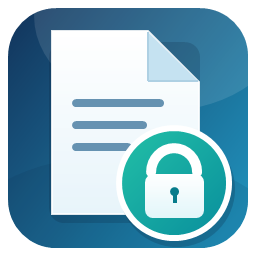

# 🔥 文件占用助手

[简体中文](README.md) | [English](README_EN.md)

> 文件被占用，移动不了？选中文件，一键查占用；释放后，一键重试移动。少折腾几步，文件轻松挪走。

## ⚡ 一看就会用

**选择文件 → 一键查占用 → 释放后重试移动**

1. 双击 **打开文件占用助手.cmd** 启动，无需安装。
2. 选中文件或文件夹，点击“查找占用”，马上查看相关应用。
3. 点击“释放后重试移动”，选好目标文件夹，程序会重新检查并完成移动。

## ✨ 为什么用它

- 🔎 **占用来源一眼看清**：快速查看 Windows 能识别的应用和服务。
- 🚀 **少走弯路**：找到相关程序后，按提示释放并重试移动，不用自己逐个猜。
- 🛡️ **操作更安心**：只请求应用正常关闭，不会强制结束进程；目标位置有同名文件时会停止，不会覆盖。
- 📒 **过程有记录**：操作日志保存在本机，方便回看。

## 💻 运行要求

Windows 10/11 和 Windows PowerShell 5.1。无需安装 Python 包或额外服务。

## 🌐 使用说明

查看[中文使用说明](使用说明.md)或[English user guide](USER_GUIDE_EN.md)。

## 📁 项目文件

- **FileLockHelper.ps1**：主程序和图形界面。
- **打开文件占用助手.cmd**：启动入口。
- **README_EN.md**：English overview.
- **USER_GUIDE_EN.md**：English user guide.
- **生成图标.ps1** 和图标文件：应用图标及生成脚本。

## 💡 小提示

少数系统级占用可能需要先关闭相关程序或同步任务，再重新查找。

## 📜 许可证

本项目按 MIT License 发布，详见 [LICENSE](LICENSE)。