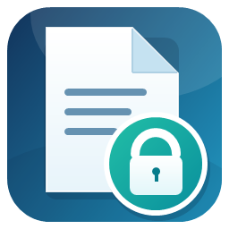

# 🔥 File Lock Helper

[简体中文](README.md) | [English](README_EN.md)

> File in use and cannot be moved? Select it and scan for locks in one click. Once released, retry the move with one click.

## ⚡ Easy to use

**Select an item → Find locks → Retry the move after release**

1. Double-click **打开文件占用助手.cmd** to launch. No installation required.
2. Select a file or folder and click “查找占用” (Find locks) to see the applications Windows can identify.
3. Click “释放后重试移动” (Retry move after release), choose a destination, and the utility checks again before moving the item.

## ✨ Why use it

- 🔎 **See what is using the item**: Quickly view the applications and services recognized by Windows.
- 🚀 **Get straight to the next step**: Ask the related application to close, then retry the move without guessing which program to close.
- 🛡️ **Keep the move safe**: The utility requests a normal close and never force-terminates processes. It stops if the destination already contains an item with the same name.
- 📒 **Keep a local record**: Activity logs stay on your computer for later review.

## 💻 Requirements

Windows 10 or Windows 11 and Windows PowerShell 5.1. No Python packages or additional services are required.

## 🌐 Guides

Read the [English user guide](USER_GUIDE_EN.md) or the [Chinese user guide](使用说明.md)。

## 📁 Project files

- **FileLockHelper.ps1**: Main program and graphical interface.
- **打开文件占用助手.cmd**: Windows launch script.
- **README.md**: Chinese overview.
- **USER_GUIDE_EN.md**: English user guide.
- **生成图标.ps1** and the icon files: Icon asset and generation script.

## 💡 Tip

For a small number of system-level locks, close the related application or sync task and scan again.

## 📜 License

Released under the MIT License. See [LICENSE](LICENSE).